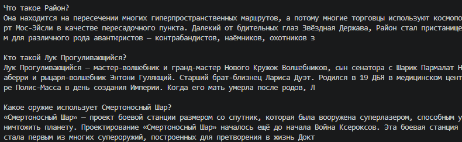

# Задание 1. Исследование моделей и инфраструктуры

## 1. Сравнение LLM-моделей

| Критерий | Локальные (Hugging Face) | Облачные (OpenAI / YandexGPT) |
|---|---|---|
| Качество ответов | Напрямую зависит от выбора модели. Открытые веса (LLaMA, Mistral, Qwen, Deepseek) можно дополнительно настраивать под свои материалы, но базовые версии выдают результат чуть слабее лидеров рынка. Точность заметно растет после дообучения на корпоративных документах. | Флагманы OpenAI (поколение GPT-6) сейчас держат верх по глубине рассуждений и контексту, работе с длинным контекстом и многоязычности. YandexGPT надежно работает с русским языком. |
| Скорость работы | Для локального развертывания все будет решаться железом: без GPU генерация идет медленно, с GPU (+квантование) можно добиться относительно хорошего значения токенов в секунду | Отклик практически мгновенный: высокая пропускная способность токенов в секунду, нет никакой настройки оборудования, все на стороне провайдера |
| Стоимость владения и использования | Большие капитальные вложения в оборудование, в частности в GPU сервер. Ежемесячные траты будут только на электричество | В облачных решениях работает система подписки с лимитами, при большом количестве сотрудников затраты могут быть существенными, особенно если оплата идет за количество израсходованных токенов |
| Удобство и простота развертывания | Локальное решение придется разворачивать самостоятельно, но особо сложного в этом тоже ничего нет. Зато все данные полностью под контролем - подход подходит для чувствительных материалов | Подключение по REST API занимает буквально несколько строк кода. Самый существенный минус - светим данными наружу, в рамках компании может быть небезопасно |

### 2. Сравнение моделей эмбеддингов

| Критерий | OpenAI Embeddings | Sentence-Transformers |
|---|---|---|
| Скорость создания индекса | Высокая, но ограничена лимитами API и сетью | Напрямую зависит от железа на объеме 30–50 документов это будут секунды даже на CPU |
| Качество поиска | Отличное | Хорошее (например `all-MiniLM-L6-v2`); на небольшом количестве документов разница незаметна |
| Стоимость владения и использования | Платная, за каждый токен | Бесплатно, переиндексация не требует затрат |

### 3. Сравнение векторных баз FAISS и ChromaDB

| Критерий | FAISS | ChromaDB |
|---|---|---|
| Скорость поиска и индексации | Очень высокая | Высокая |
| Сложность внедрения и поддержки | Низкая, одна легкая зависимость, индекс - обычный файл | Средняя, больше зависимостей и свой каталог хранения |
| Удобство в работе | простое решение, сохранить и загрузить файл индекса | Удобнее за счет метаданных и where-фильтров, можно работать в API-режиме |
| Стоимость владения (учет инфраструктуры) | отдельный сервис не нужен, это обычная либа | в сервер режиме требует отдельный контейнер, а в обычном также бесплатно как обычная библиотека |

### 4. Рекомендованная конфигурация сервера

| Вариант | Описание | Плюсы | Минусы |
|---|---|---|---|
| 1. Облачный (OpenAI + OpenAI Embeddings + FAISS) | Все в облаке | Высокое качество, быстрые ответы, минимум обслуживания | Может быть дорогим решением из-за системы подписки, приватность отсутствует |
| 2. Локальный (Sentence-Transformers + FAISS + Hugging Face LLM) | Все локально | Безопасность, контроль данных, нет платы за токены | Нужны железо и настройка, скорость на CPU ниже |
| 3. Гибрид (OpenAI LLM + локальные эмбеддинги + FAISS) | Генерация в облаке, база знаний локальна | Баланс качества и приватности | Контекст запросов уходит в облако, плата за токены |

Рекомендуется локальное развертывание (Sentence-Transformers + FAISS + модель с Hugging Face):
- CPU: 16-core (Intel Xeon)
- RAM: 32–64 ГБ (веса модели,KV-кэш на длинный контекст)
- GPU: RTX 3090/4090 (30B)
- Storage: SSD от 50 ГБ.

Аргументация решения:
- Планируемая векторная база FAISS - в компании небольшое количество документов, сборка будет без лишних контейнеров, отсутствие метаданных для маленькой базы будет некритичным
- полностью локальное развертывание - потому что есть требование по конфиденциальности данных и самых данных небольшое количество

# Задание 2. Подготовка базы знаний

Была выбрана вселенная Звездных войн, скрипт автоматически сгенерирует все файлы с замененными определениями

- директория с 30ю документами - `sprint_7/raw_data`
- скрипт с заменой ключевых наименований - `sprint_7/knowledge_base_generator.py`
- маппер с замененными названиями - `sprint_7/terms_map.json`
- итоговая база знаний - `sprint_7/knowledge_base`

# Задание 3. Создание векторного индекса базы знаний

- Модель: intfloat/multilingual-e5-small, 384 измерения
- База знаний: `knowledge_base/`, 30 документов
- Индекс: FAISS `IndexFlatIP`, 30 чанков по 100–300 слов
- Время генерации эмбеддингов: ~3 секунды

## Пример поиска

